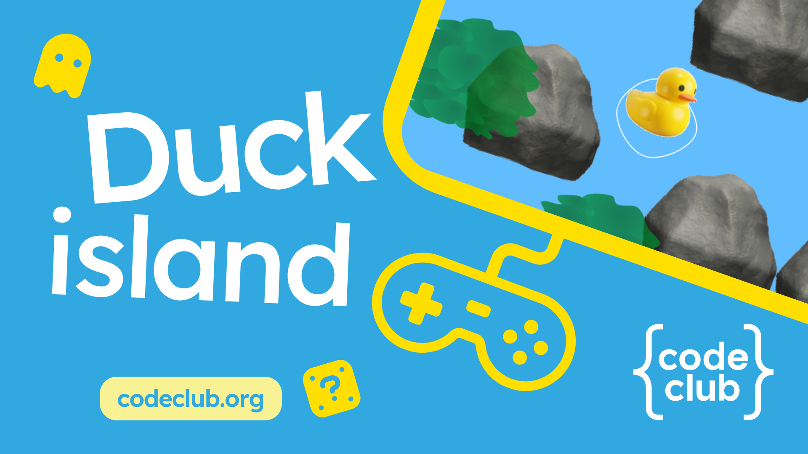

# Duck island — editor project

A Scratch duck-rescue game for the Raspberry Pi Code Editor: 31 short making steps and seven optional extensions. Each page edits one sprite or the Stage and ends with an observable check.

- [Introduction](en/landing.md)
- [Step order and completion markers](en/meta.yml)
- [Starter](en/code/editor-duck-island-starter/editor-duck-island-starter.sb3)
- [Completed core game](en/code/editor-duck-island-complete/editor-duck-island-complete.sb3)
- [Example with optional extensions](en/solutions/editor-duck-island-with-challenges.sb3)
- [Conversion decisions, source mapping, and validation](en/conversion/README.md)

The conversion uses `raspberrypilearning/duck-island` **draft** commit `375d8bf` and the supplied Scratch starter. The packaged starter's only sprite is named **player** and has no scripts.

Work is prepared on **draft**. Review before promoting to **master**. The landing-page demo currently reads the completed project from the draft branch; update that URL when promoting the content.

See [CONTRIBUTING.md](CONTRIBUTING.md), [LICENCE.md](LICENCE.md), and [CROWDIN.md](CROWDIN.md).
