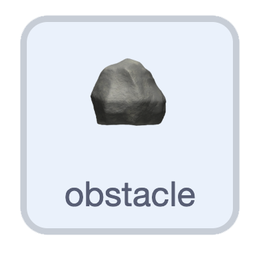

## Start rocks at the side edges

{:width="100px" height="100px" style="object-fit: contain;"}

On **obstacle**, add two checks at the end of `define appear`. Right-arrow rocks start on the right; left-arrow rocks start on the left.

```blocks3
define appear
go to x: (pick random (-200) to (200)) y: (pick random (-140) to (140))
set size to (pick random (50) to (100)) %
show
+if <key (right arrow v) pressed?> then
    set x to (220)
end
+if <key (left arrow v) pressed?> then
    set x to (-220)
end
```

## Now run your code

Restart and hold right: new rocks appear at the right edge. Restart and hold left: they appear at the left edge. They stay there for now.
