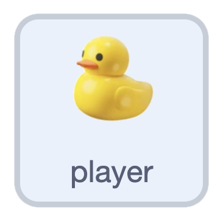

## Turn right

{:width="100px" height="100px" style="object-fit: contain;"}

On **player**, add a `forever` loop below the starting position. Inside it, check the **right arrow** and switch to the **right** costume.

```blocks3
when green flag clicked
go to [front v] layer
switch costume to (down v)
set size to (25) %
go to x: (0) y: (0)
+forever
+    if <key (right arrow v) pressed?> then
+        switch costume to (right v)
+    end
+end
```

## Now run your code

Click the flag, then press the right arrow. The duck turns right. It stays in the centre; later, the scenery will move around it.
