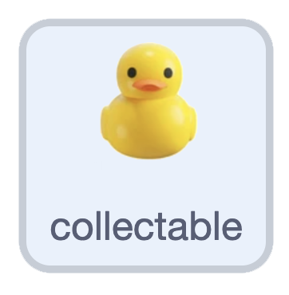

## Rescue a duck

{:width="100px" height="100px" style="object-fit: contain;"}

On **collectable**, add a touching check inside the clone's loop, after `disappear`. Add one point and delete that clone when it touches **player**.

```blocks3
when I start as a clone
appear :: custom
forever
    move :: custom
    disappear :: custom
    if <touching (player v)?> then
        change [score v] by (1)
        delete this clone
    end
end
```

## Now run your code

Restart and swim into a small duck. It disappears and the score increases by exactly `1`. A rock should never award a point.
