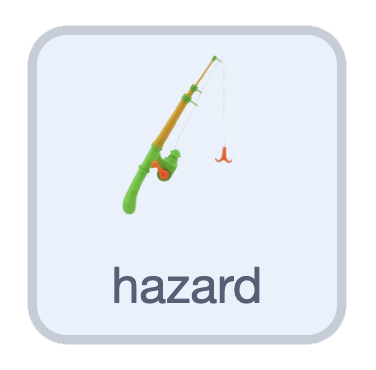

## Challenge: tune the movement

{:width="100px" height="100px" style="object-fit: contain;"}

On **hazard**, change only the extra `move 1 steps` block in the clone loop. Try `0.5` for a slower drift or `1.5` for a faster drift.

Keep the shared `rock speed` and the duck's collision probes unchanged.

## Now run your code

Restart and create a few hooks, then release the arrows. Compare their drift with the earlier speed. Choose a speed that gives you time to dodge. Check that hooks still disappear at the edges.

Save your project.
