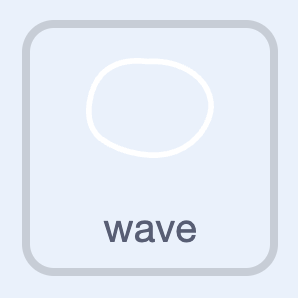
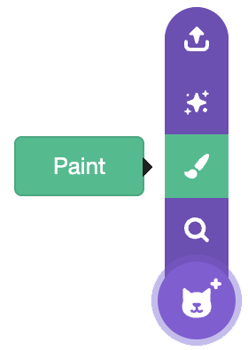
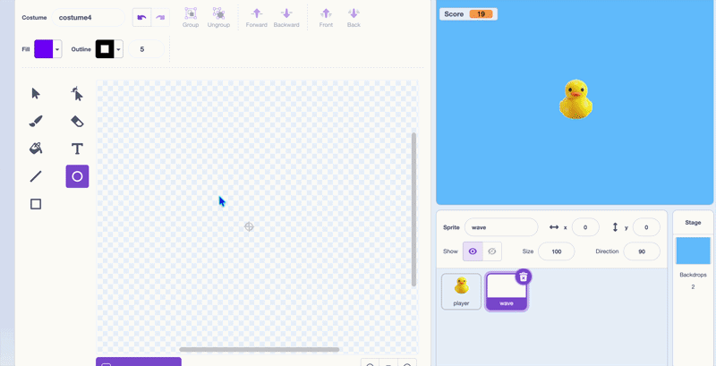

## Draw a wave

{:width="100px" height="100px" style="object-fit: contain;"}

Choose **Paint** from the sprite menu and name the new sprite **wave**.

Draw a wide oval with a white outline and no fill. Centre it on the paint editor's crosshair. Make it slightly wider than the duck.

{:width="180"}

{:width="300"}

## Check your project

Select the wave. You should see a white ring with water visible through its middle. Adjust the oval in the paint editor if it is much larger than the duck.
