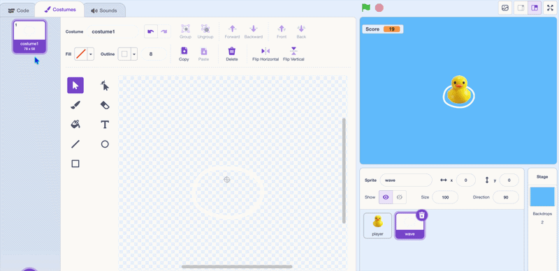

## Make three wave costumes

{:width="100px" height="100px" style="object-fit: contain;"}

On **wave**, open **Costumes**. Duplicate the oval twice. Enlarge the second oval a little and the third a little more, keeping their centres aligned.

Name them **costume1**, **costume2**, and **costume3**, from smallest to largest.

{:width="300"}

## Check your project

Stop the project. Click each costume thumbnail. The ring should grow in three steps while its centre stays in the same place.
